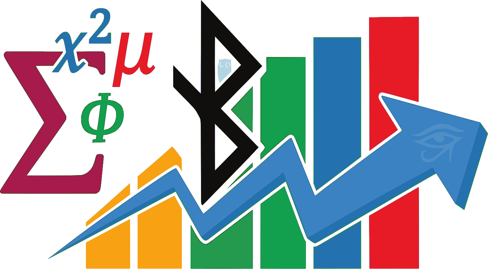

# Assessment by PROMPTS: An alternative to Pull Requests in education

> **Assess the learning process, not the AI-generated code**

[](https://opensource.org/licenses/MIT)
[](https://github.com/TodoEconometria)

**Language:** [Español](README.md) · English

---

## The Problem

In the era of ChatGPT, Copilot and Claude, **reviewing code no longer makes sense**:

```
Student A: Copies code from ChatGPT → perfect PR → Grade 10
Student B: Actually learns → PR with mistakes → Grade 7

Who learned more?
```

Pull Requests assess the **product** (code), not the **process** (learning).

---

## The Solution: Assess PROMPTS

Instead of reviewing code, we assess the **AI prompts** the student used:

| Before (PRs) | Now (PROMPTS) |
|--------------|---------------|
| Review code line by line | Read prompts and screenshots |
| Code can be copied | Prompts reveal real thinking |
| Manual review (hours) | Automatic triage (minutes) |
| Everyone submits similar code | Every process is unique |

### What we assess:

1. **Real prompts** - Copied verbatim, typos and all
2. **Screenshots** - Evidence of the interaction with the AI
3. **Final blueprint** - AI-generated technical summary
4. **Coherence** - Prompts must match the submitted code

---

## How It Works

### For the student

```
1. Work with an AI (ChatGPT, Claude, Copilot, etc.)
2. Document EVERY important prompt in PROMPTS.md
3. Take screenshots of the key prompts
4. At the end, ask the AI for a technical "blueprint"
5. Push everything to your fork with git push
6. Done! There is no PR to open
```

### For the instructor

```
1. Run: python evaluar_prompts.py
2. The script parses each student's PROMPTS.md
3. It produces a report with:
   - Automatic ranking
   - Highlights (possible bonus)
   - Flagged cases (verify in person)
4. You only intervene in ~10% of special cases
```

---

## The PROMPTS.md File

```markdown
# AI Prompts - [Project Name]

## Prompt A: [Descriptive title]

**AI used:** ChatGPT / Claude / Copilot

**Exact prompt (copied verbatim):**
> how do i get spark to read a big csv without the memory blowing up

**Screenshot:** See `screenshots/prompt_A.png`

**Result:** [Brief description of what you got]

---

## Blueprint

[At the end, ask the AI:]
> "Summarize everything we did: tech stack, architecture,
> key decisions, and how to rebuild this project from scratch"

[Paste the blueprint here]
```

---

## Cheating Detection

The system automatically flags:

| Alert | What it detects |
|-------|-----------------|
| "Cleaned" prompts | Perfect prompts with no human errors |
| Copy of the example | Same topic/countries as the instructor's |
| Incoherent blueprint | Blueprint does not match the code |
| Thin content | Fewer than ~300–500 words in PROMPTS.md |

Detail in [`docs/anti-cheating.md`](docs/anti-cheating.md).

---

## Scoring Criteria

`evaluar_prompts.py` suggests a grade out of 100 (transparent and reproducible; the
instructor has the final word). The weights are:

| Component | How it is measured | Points |
|-----------|--------------------|--------|
| Number of prompts | `10 x nº of prompts`, capped | 0–30 |
| Screenshots | Mentions screenshots / `.png` / `.jpg` | +20 |
| Final blueprint | Mentions blueprint / technical summary | +20 |
| Effort (word count) | `words / 50`, capped | 0–30 |

**Alert adjustments** (on the sum above):

- `SUSPICIOUS` (overly formal prompts: more than twice as many formal as informal words
  with ≥3 prompts) → **−20**
- `REVIEW` (thin content: fewer than 300 words) → **−10**
- `HIGHLIGHT` (>1000 words and ≥5 prompts) → **+10**

The final grade is clamped to `[0, 100]`. The **category** is decided as follows: any
`SUSPICIOUS` alert sends the case to **REVIEW**; grade 0 → **REJECTED**; `HIGHLIGHT` or
grade ≥90 → **HIGHLIGHT**; grade ≥60 → **NORMAL**; everything else → **REVIEW**.

> These thresholds are a **starting point**, editable in `config.py`. The grade is a
> triage signal —not a final mark— so the instructor spends time on the ~10% of cases
> that truly need a human look.

---

## Installation

### 1. Clone this repository

```bash
git clone https://github.com/TodoEconometria/evaluacion-prompts-ia.git
cd evaluacion-prompts-ia
```

### 2. Copy files to your repository

```bash
# GitHub Action to close PRs
cp github-actions/cerrar-prs.yml YOUR_REPO/.github/workflows/

# PR template (explains the system)
cp templates/PULL_REQUEST_TEMPLATE.md YOUR_REPO/.github/

# PROMPTS.md template for students
cp templates/PROMPTS.md YOUR_REPO/plantilla/

# Evaluation script (optional)
cp scripts/evaluar_prompts.py YOUR_REPO/.instructor/
```

### 3. Configure the student list

Copy `scripts/config.example.py` to `scripts/config.py` (git-ignored) and put the real
list of students and the criteria there. `config.py` is **never** committed.

---

## Components

### `/github-actions/`
- `cerrar-prs.yml` - Automatically closes any PR with an explanatory message

### `/templates/`
- `PROMPTS.md` - Template for students to document their prompts
- `PULL_REQUEST_TEMPLATE.md` - Explains why PRs are not accepted
- `guia-entregas.md` - Full guide for students

### `/scripts/`
- `evaluar_prompts.py` - Automatic evaluation script
- `config.example.py` - Configuration template (copy to `config.py`)

### `/docs/`
- `deployment-guide.md` - **Start here**: adopt the system in your course with a
  generic end-to-end example, adaptable to your materials
- `methodology.md` - Detailed explanation of the system (the paper)
- `anti-cheating.md` - Detection techniques
- `faq.en.md` - Frequently asked questions
- `configuracion-github.md` - Mechanical GitHub detail: permissions, Actions (ES)

---

## Real-World Use

This system is used in the **Big Data with Python** course (230 hours):

- **Repository:** [ejercicios-bigdata](https://github.com/TodoEconometria/ejercicios-bigdata)
- **Participants:** 18 working professionals with heterogeneous backgrounds
  (prior experience in IT, data analysis and big data) taking the program to
  reskill
- **Result:** 18 submissions assessed in 30 minutes (vs 6+ hours with PRs)

---

## Philosophy

> "In the age of AI, the value is not in the code you produce,
> but in the questions you know how to ask."

This system recognizes that:

1. **AI is a legitimate tool** - We do not ban its use, we assess it
2. **Process matters more than product** - We want to see how you think
3. **Authenticity is verifiable** - "Real" prompts carry human errors
4. **Efficiency benefits everyone** - Less time reviewing = more time teaching

---

## Privacy

This system publishes students' prompts and screenshots in public forks. Before using it:
obtain **informed consent**, offer a private alternative, ask students to **redact
personal data** from screenshots, and comply with your regulations (GDPR / FERPA). Detail
in [`docs/methodology.md`](docs/methodology.md#privacy-and-consent).

---

## License

MIT License - Use, modify and share freely, **keeping the copyright notice and the
attribution to the author** (do not remove the authorship headers from the scripts).

---

## How to cite

If you use the method or the tools, cite the authorship. GitHub shows the **"Cite
this repository"** button (see [`CITATION.cff`](CITATION.cff)).

**Academic citation (preprint):**

> Gutierrez Miranda, J. M. (2026). *Assessment by prompts: shifting assessment from
> product to process in programming education in the age of generative AI*.
> Preprint. TodoEconometria.
> https://github.com/TodoEconometria/evaluacion-prompts-ia

---

## Author

**Prof. Juan Marcelo Gutierrez Miranda | TodoEconometria**
- GitHub: [@TodoEconometria](https://github.com/TodoEconometria)
- Web: [todoeconometria.com](https://www.todoeconometria.com)
- LinkedIn: [juangutierrezconsultor](https://www.linkedin.com/in/juangutierrezconsultor/)
- ORCID: [0000-0002-4452-7934](https://orcid.org/0000-0002-4452-7934)

---

## References

- Anderson, L. W., & Krathwohl, D. R. (2001). *A Taxonomy for Learning, Teaching, and Assessing: A Revision of Bloom's Taxonomy*. Longman.
- Wiggins, G. (1990). The case for authentic assessment. *Practical Assessment, Research & Evaluation*, 2(2).
- Tai, J., Ajjawi, R., Boud, D., Dawson, P., & Panadero, E. (2018). Developing evaluative judgement in higher education. *Higher Education*, 76, 467-481.
- Cotton, D. R. E., Cotton, P. A., & Shipway, J. R. (2024). Chatting and cheating: Ensuring academic integrity in the era of ChatGPT. *Innovations in Education and Teaching International*, 61(2).
- Hunt, A., & Thomas, D. (2019). *The Pragmatic Programmer* (20th Anniversary ed.). Addison-Wesley.

---

*Made with care for the education community*
